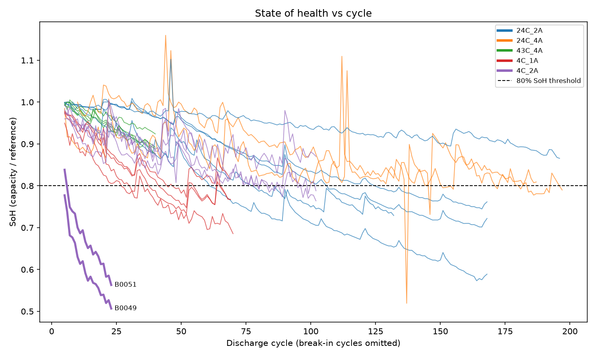
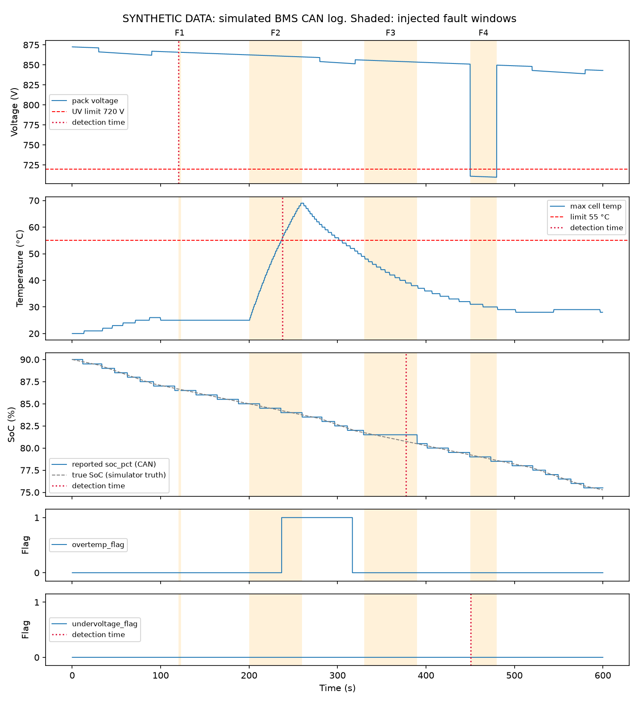

# Battery Fleet Diagnostics

This project does two things a battery energy storage team does day to day. First, it treats 21 lithium-ion cells from NASA's aging tests as a small fleet. It cleans their cycle data, stores it in SQLite, tracks each cell's state of health and flags cells that age abnormally. Second, it simulates a battery pack and its battery management system (BMS), records the CAN bus traffic with four faults injected, and builds checks that find those faults using only the log. The checks are then scored against the known fault schedule.

## How to run

Requires Python 3.11+.

```bash
python -m venv .venv
# Windows: .venv\Scripts\activate    macOS/Linux: source .venv/bin/activate
pip install -r requirements.txt
```

Download the **Battery Data Set** (`5. Battery Data Set.zip`) from the
[NASA PCoE Data Set Repository](https://www.nasa.gov/intelligent-systems-division/discovery-and-systems-health/pcoe/pcoe-data-set-repository/).
It contains six inner zips. Extract them all and copy every `B00xx.mat` file into `data/raw/`, which gives 34 cells. B0025–B0028 appear twice, and the copies are identical.

```bash
python run_all.py   # about 5 seconds; rebuilds the database, both reports and all figures
pytest              # 13 unit tests
```

Outputs:
- `reports/summary.md`: fleet analytics
- `reports/can_results.md`: CAN diagnostics
- `reports/figures/`: all figures

## Results

### Fleet analytics (real data)

- **Fleet:** 21 of 34 cells, with 2,060 discharge cycles after cleaning. The other 13 are kept in the database but left out of the analysis, each with a stated reason (see Method).
- **Fade rate:** fastest at 43 °C / 4 A, with a median of 0.54 Ah lost per 100 cycles. Slowest at 24 °C / 4 A, with 0.15 Ah per 100 cycles.
- **Cycles to 80 % state of health (median by group):**
  - 92 cycles at 24 °C / 2 A
  - 36 at 4 °C / 1 A
  - 40 at 4 °C / 2 A
  - None of the 43 °C cells got there within their 40-cycle test.
- **Fast degraders:** two cells were flagged, B0049 (1.74 Ah per 100 cycles) and B0051 (1.52), against a group threshold of 0.53. Both were on the same test rig, which stopped for 53 hours. The first discharge after the restart reported an implausible 2.3–2.4 Ah, above the cells' 2.0 Ah rating, and that cycle is dropped during cleaning. From then on, both cells held 16–22 % less capacity and never recovered. The flag is correct, but the cause is a test event, not normal aging.
- **Resistance growth:** three cells were flagged on growth in ohmic resistance (Re): B0007, B0047 and B0049.
- **Temperature and fade:** peak temperature and fade rate have only a weak rank correlation (Spearman ρ = 0.18). The groups differ in load current and ambient temperature, not only in how hot the cells run.



### CAN diagnostics (synthetic data)

All four injected faults were detected, with no false positives.

| Fault | Detected by | Latency | What sets the latency |
|---|---|---|---|
| F1: `BMS_Status` frames stop for 3 s | timeout | 0.2 s | 3 missed message periods |
| F2: pack overheats | temperature range | 37.6 s | the time the heating takes to reach 55 °C |
| F3: reported SoC freezes | stuck value | 47.4 s | at 150 A, SoC takes 48 s to move 1 % |
| F4: undervoltage with no BMS flag | missed flag | 0.8 s | 0.5 s debounce + 0.3 s margin |

The run produced two other events, and both are explained. During F2 the BMS's own overtemp flag set, which is correct behaviour. During F4 the voltage range check also fired, because the same voltage sag takes the voltage out of range.



## Method

### Data cleaning
- **Implausible capacities:** cycles with missing, zero or above-2.2 Ah capacity are dropped. So are cycles below half of the cell's median, which removes the near-zero glitch cycles in several 4 °C cells. Every dropped cycle is logged with its reason: 230 in total, 28 from fleet cells.
- **Reference capacity:** state of health is capacity divided by a reference capacity. The reference is the highest 5-cycle rolling median within the first 20 cycles. Some cells start with partial or break-in cycles (B0033 starts at 0.07 Ah), so dividing by the first cycle would give a meaningless SoH. Cycles before the reference point are kept but not used for fade or threshold calculations.
- **Excluded cells:** cells whose test conditions change between cycles (mixed load current or ambient temperature), cells with a different load profile (square wave), and cells with too few valid cycles are left out of the analysis. They stay in the database with an `exclude_reason`.
- **End of life (1.4 Ah):** only reported for cells that start above 1.4 Ah. Several 4 °C cells start below it, so for them the threshold has no meaning.

### Anomaly rules
Every threshold is computed from the data with a robust statistic: median + 3 × scaled MAD. A plain mean and standard deviation would be pulled around by the very outliers the rules are trying to find.
- **Fast degrader:** a cell's fade rate (slope of a straight line fitted to capacity against cycle) is compared with its own test group. Groups are compared separately because temperature and load change fade rates a lot. A group with fewer than 4 cells has too few samples for its own threshold, so it uses the fleet-wide one.
- **Resistance growth:** the median of a cell's last three impedance tests minus the median of its first three, for both Re and Rct, compared fleet-wide. Using medians stops a single noisy test from setting the result.
- **Thermal outlier:** a cycle whose peak temperature is more than 3 °C above the median of that cell's previous 10 cycles.
- **Capacity jump:** a rise of more than 0.03 Ah from one cycle to the next. This is recorded but expected, since Li-ion cells recover some capacity after rest.

### CAN checks
The DBC file defines three messages:
- `BMS_Status`: voltage, current, SoC
- `BMS_Temps`: max and min cell temperature
- `BMS_Faults`: overtemp, undervoltage and comm-fault flags

The checks only see the decoded log:
- **Timeout:** a message gap longer than 3 periods.
- **Range:** temperature outside 0–55 °C, or voltage outside 720–910 V.
- **Stuck value:** SoC holds one value while the measured current, integrated over that time, says it should have moved at least 1 %. A fixed time window would not work, because with 0.5 % resolution a healthy SoC reading stays flat for about 24 s at normal load.
- **Flag consistency:** a value past its limit while the BMS flag is 0 (missed flag), or a flag at 1 while the value is back inside the clear threshold (false flag).

**Debounce and hysteresis:** the simulated firmware sets a flag only after its condition has held for 0.5 s, and clears it only past a separate clear threshold (52 °C, 730 V). The consistency check waits 0.5 s plus a 0.3 s margin, so a correctly working, debounced BMS is never reported as missing a flag.

**Detection time and latency:** each event records the earliest time a monitor running the check live could have raised it. Latency is measured from that time to the fault start.

**Scoring:** a fault counts as detected if an event from its expected check, on the faulted signal, overlaps the fault window (±1 s). Any other event must match a listed side effect with a written reason. Otherwise it counts as a false positive.

**The CAN data is synthetic.** It comes from a simple pack model (linear open-circuit voltage, I·R sag, first-order heating) and a scheduled message sender with timestamp jitter, seed 42. It is not a recording from real hardware.

## Limitations

- **Lab cells, not a field fleet:** these are single 18650 cells cycled under controlled conditions. A deployed fleet has varying duty cycles, cell-to-cell interaction within modules, and far longer time scales.
- **Different chemistry:** the NASA cells are not the LFP chemistry common in grid storage, so the absolute fade rates and voltage behaviour do not carry over.
- **Simple statistical rules:** with groups of 2 to 6 cells, the thresholds rest on few samples. The rules flag outliers within this dataset; they don't predict remaining life.
- **Simulated BMS:** the pack model is deliberately simple, the faults are clean and isolated, and there is one 600 s run. Real logs have noise, overlapping faults and many more signals, so these detection results show that the checks work as designed, not how they would perform in the field.

## Repository layout

```
run_all.py          runs every step in order
src/                Part A: ingest, database build, analysis, anomaly rules, report
sql/                schema and named queries
bms_can/            Part B: DBC file, simulator, decoder, checks, evaluation
tests/              unit tests for the DBC and the checks
reports/            generated reports and figures
```

## Data source

B. Saha and K. Goebel (2007). *Battery Data Set*, NASA Prognostics Data Repository, NASA Ames Research Center, Moffett Field, CA.
