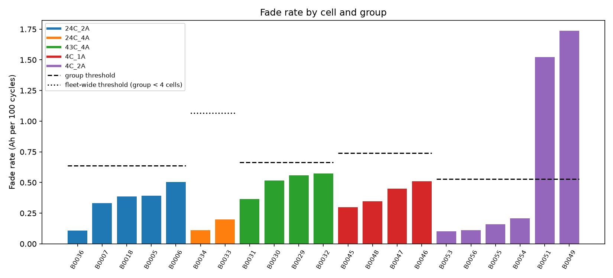
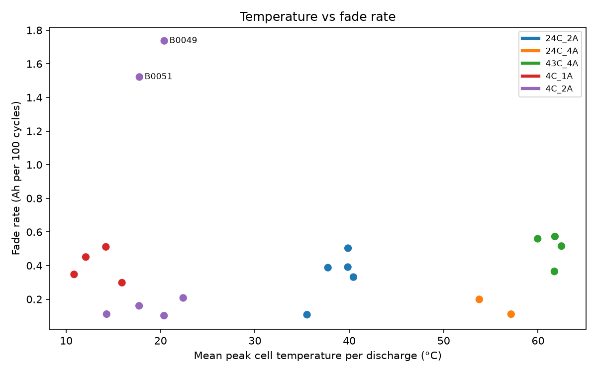
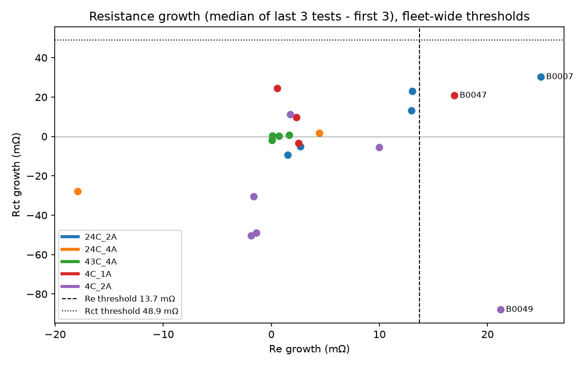

# Battery fleet summary

Generated from `data/fleet.db`. Data: NASA PCoE Li-ion battery aging dataset (18650 cells, 2.0 Ah rated).

## Findings

- Median fade rate is highest in 43C_4A (0.54 Ah per 100 cycles) and lowest in 24C_4A (0.15).
- Flagged as fast degraders: B0049 (1.74 Ah per 100 cycles, threshold 0.53; largest single-cycle drop 22% of reference); B0051 (1.52 Ah per 100 cycles, threshold 0.53; largest single-cycle drop 16% of reference).
- Across the fleet, mean peak temperature and fade rate have a weak rank correlation (Spearman ρ = 0.18); group conditions differ in more than temperature.
- B0045 has the lowest reference capacity relative to its group (59% of the 4C_1A median) but a normal fade rate, so no rule flags it.

## Fleet

- Cells in dataset: 34; in analysis fleet: 21; excluded: 13.
- Discharge cycles in the fleet after cleaning: 2060.
- Discharge cycles dropped during cleaning: 230 in total, 28 from fleet cells.

### Group overview

| grp | n_cells | total_cycles | mean_ref_capacity_ah | mean_last_capacity_ah | mean_last_soh |
|---|---|---|---|---|---|
| 24C_2A | 5 | 832 | 1.874 | 1.369 | 0.733 |
| 24C_4A | 2 | 384 | 1.623 | 1.298 | 0.800 |
| 43C_4A | 4 | 160 | 1.809 | 1.619 | 0.895 |
| 4C_1A | 4 | 277 | 1.349 | 1.035 | 0.759 |
| 4C_2A | 6 | 407 | 1.225 | 0.889 | 0.731 |

### Excluded cells

| cell_id | grp | n_discharge | exclude_reason |
|---|---|---|---|
| B0025 | 24C_sq4A | 28 | 4 A square-wave load profile, only ~28 cycles |
| B0026 | 24C_sq4A | 28 | 4 A square-wave load profile, only ~28 cycles |
| B0027 | 24C_sq4A | 28 | 4 A square-wave load profile, only ~28 cycles |
| B0028 | 24C_sq4A | 28 | 4 A square-wave load profile, only ~28 cycles |
| B0038 | mixed | 47 | load current and ambient temperature change between cycles |
| B0039 | mixed | 35 | load current and ambient temperature change between cycles |
| B0040 | mixed | 33 | load current and ambient temperature change between cycles |
| B0041 | mixed | 67 | load current changes between cycles (4 A / 1 A) |
| B0042 | mixed | 65 | load current and ambient temperature change between cycles |
| B0043 | mixed | 65 | load current and ambient temperature change between cycles |
| B0044 | mixed | 65 | load current and ambient temperature change between cycles |
| B0050 | 4C_2A | 11 | only 11 valid discharge cycles out of 25; values erratic |
| B0052 | 4C_2A | 4 | only 4 valid discharge cycles out of 25 |

### Cleaning (drop log, fleet cells)

Full log, including excluded cells, is in the `dropped_cycles` table.

| cell_id | reason | cycles_dropped |
|---|---|---|
| B0033 | < 0.5 x cell median | 10 |
| B0036 | missing, <= 0 or > 2.2 Ah | 1 |
| B0045 | missing, <= 0 or > 2.2 Ah | 2 |
| B0046 | missing, <= 0 or > 2.2 Ah | 3 |
| B0047 | missing, <= 0 or > 2.2 Ah | 3 |
| B0048 | missing, <= 0 or > 2.2 Ah | 3 |
| B0049 | missing, <= 0 or > 2.2 Ah | 2 |
| B0051 | missing, <= 0 or > 2.2 Ah | 2 |
| B0053 | missing, <= 0 or > 2.2 Ah | 1 |
| B0054 | missing, <= 0 or > 2.2 Ah | 1 |

## Cycles to threshold

SoH = capacity / reference capacity, where the reference is the highest 5-cycle rolling median
in the first 20 cycles. Cycles before the reference point are treated as break-in and not
counted. End of life (EOL) is capacity below 1.4 Ah, counted only for cells whose reference is above 1.4 Ah; 7 fleet cells start below it. A dash means the threshold was not reached before the test ended.

| grp | cells | reached_soh | median_cycle_soh | reached_eol | median_cycle_eol |
|---|---|---|---|---|---|
| 24C_2A | 5 | 4/5 | 92 | 3/5 | 109 |
| 24C_4A | 2 | 2/2 | 144 | 2/2 | 82 |
| 43C_4A | 4 | 0/4 | — | 0/4 | — |
| 4C_1A | 4 | 4/4 | 36 | 3/3 | 12 |
| 4C_2A | 6 | 4/6 | 40 | n/a | — |

Per cell

| cell_id | grp | ref_capacity_ah | n_cycles | first_cycle_below_soh | first_cycle_below_eol |
|---|---|---|---|---|---|
| B0005 | 24C_2A | 1.835 | 168 | 107 | 125 |
| B0006 | 24C_2A | 2.013 | 168 | 61 | 109 |
| B0007 | 24C_2A | 1.881 | 168 | 125 | — |
| B0018 | 24C_2A | 1.840 | 132 | 78 | 97 |
| B0036 | 24C_2A | 1.801 | 196 | — | — |
| B0033 | 24C_4A | 1.626 | 187 | 137 | 103 |
| B0034 | 24C_4A | 1.621 | 197 | 151 | 60 |
| B0029 | 43C_4A | 1.816 | 40 | — | — |
| B0030 | 43C_4A | 1.752 | 40 | — | — |
| B0031 | 43C_4A | 1.804 | 40 | — | — |
| B0032 | 43C_4A | 1.865 | 40 | — | — |
| B0045 | 4C_1A | 0.885 | 70 | 27 | n/a |
| B0046 | 4C_1A | 1.503 | 69 | 42 | 17 |
| B0047 | 4C_1A | 1.508 | 69 | 31 | 10 |
| B0048 | 4C_1A | 1.499 | 69 | 45 | 12 |
| B0049 | 4C_2A | 1.364 | 23 | 5 | n/a |
| B0051 | 4C_2A | 1.204 | 23 | 6 | n/a |
| B0053 | 4C_2A | 1.131 | 55 | — | n/a |
| B0054 | 4C_2A | 1.096 | 102 | 74 | n/a |
| B0055 | 4C_2A | 1.257 | 102 | 76 | n/a |
| B0056 | 4C_2A | 1.297 | 102 | — | n/a |

## Anomaly flags

| rule | flags | cells |
|---|---|---|
| capacity_jump | 116 | 19 |
| fast_degrader | 2 | 2 |
| resistance_growth_re | 3 | 3 |
| thermal_outlier | 15 | 4 |

### Fast degraders

Robust threshold per group: median + 3 × 1.4826 × MAD of fade rate.

| cell_id | cycle_idx | value | threshold | note |
|---|---|---|---|---|
| B0049 | — | 1.737 | 0.528 | threshold from 4C_2A (6 cells) |
| B0051 | — | 1.522 | 0.528 | threshold from 4C_2A (6 cells) |

### Resistance growth

Fleet-wide robust threshold on growth in Re and Rct (Ω).

| rule | cell_id | cycle_idx | value | threshold | note |
|---|---|---|---|---|---|
| resistance_growth_re | B0007 | — | 0.0250 | 0.0137 | Re growth above fleet-wide threshold |
| resistance_growth_re | B0047 | — | 0.0169 | 0.0137 | Re growth above fleet-wide threshold |
| resistance_growth_re | B0049 | — | 0.0212 | 0.0137 | Re growth above fleet-wide threshold |

### Thermal outliers

4 of 15 thermal outliers fall on a cycle that is also flagged as a capacity jump.

| cell_id | cycle_idx | value | threshold | note |
|---|---|---|---|---|
| B0033 | 44 | 55.39 | 55.30 | peak temp > median of previous 10 cycles + 3 C |
| B0033 | 138 | 61.14 | 59.60 | peak temp > median of previous 10 cycles + 3 C |
| B0034 | 46 | 61.22 | 59.39 | peak temp > median of previous 10 cycles + 3 C |
| B0034 | 114 | 61.44 | 60.48 | peak temp > median of previous 10 cycles + 3 C |
| B0036 | 22 | 37.63 | 28.66 | peak temp > median of previous 10 cycles + 3 C |
| B0036 | 23 | 36.14 | 28.86 | peak temp > median of previous 10 cycles + 3 C |
| B0036 | 24 | 35.63 | 29.10 | peak temp > median of previous 10 cycles + 3 C |
| B0036 | 25 | 35.57 | 29.52 | peak temp > median of previous 10 cycles + 3 C |
| B0036 | 26 | 35.70 | 30.33 | peak temp > median of previous 10 cycles + 3 C |
| B0036 | 27 | 35.95 | 34.69 | peak temp > median of previous 10 cycles + 3 C |
| B0054 | 11 | 22.52 | 22.51 | peak temp > median of previous 10 cycles + 3 C |
| B0054 | 16 | 24.83 | 22.87 | peak temp > median of previous 10 cycles + 3 C |
| B0054 | 17 | 23.81 | 22.87 | peak temp > median of previous 10 cycles + 3 C |
| B0054 | 32 | 24.86 | 24.39 | peak temp > median of previous 10 cycles + 3 C |
| B0054 | 36 | 24.87 | 24.24 | peak temp > median of previous 10 cycles + 3 C |

### Capacity jumps

116 cycles; 26 exceed 0.1 Ah.
Largest 10:

| cell_id | cycle_idx | value | threshold | note |
|---|---|---|---|---|
| B0033 | 138 | 0.618 | 0.030 | large rise; previous cycle likely a partial discharge |
| B0033 | 112 | 0.425 | 0.030 | large rise; previous cycle likely a partial discharge |
| B0034 | 114 | 0.410 | 0.030 | large rise; previous cycle likely a partial discharge |
| B0033 | 147 | 0.315 | 0.030 | large rise; previous cycle likely a partial discharge |
| B0034 | 46 | 0.312 | 0.030 | large rise; previous cycle likely a partial discharge |
| B0033 | 44 | 0.273 | 0.030 | large rise; previous cycle likely a partial discharge |
| B0034 | 22 | 0.228 | 0.030 | large rise; previous cycle likely a partial discharge |
| B0036 | 46 | 0.222 | 0.030 | large rise; previous cycle likely a partial discharge |
| B0034 | 67 | 0.197 | 0.030 | large rise; previous cycle likely a partial discharge |
| B0034 | 156 | 0.173 | 0.030 | large rise; previous cycle likely a partial discharge |

## Figures

### State of health vs cycle

### Fade rate by cell

### Temperature vs fade rate

### Resistance growth

